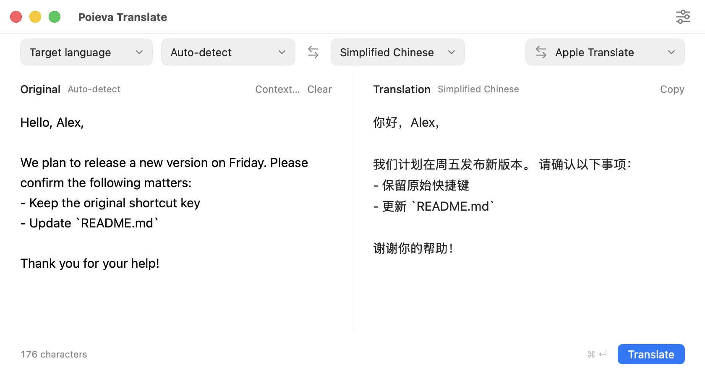

  

<h1 align="center">Poieva Translate</h1>

Translate in your text field. Preview selected text.

<strong>English</strong> · <a href="README.zh-CN.md">简体中文</a>

  <a href="https://github.com/King87125/Poieva-Translate/releases/download/v0.1.0/Poieva-Translate-0.1.0.dmg"><strong>Download for Mac</strong></a>
  · <a href="https://github.com/King87125/Poieva-Translate/releases/tag/v0.1.0">Release notes</a>

Apple Silicon · macOS 26+ · English / 简体中文

*Actual app screenshot using a sample message and the built-in translation service.*

## What you can do

- **Translate where you type.** Replace a whole draft, or just the words you select, with one shortcut.
- **Preview selected text.** Read the translation in a small floating window and copy it when you need it.
- **Translate as you write.** In the translation window, results update after you pause typing.
- **Go both ways.** Chinese ↔ English mode chooses the direction automatically. Other target languages are available too.
- **Keep the structure.** Preserve paragraphs, lists, code and links, plus text styling when the editor exposes it.
- **Make it yours.** Choose your shortcuts, interface language and loading animation. Optionally show results from several selected services.

## Get started

1. [Download the DMG](https://github.com/King87125/Poieva-Translate/releases/download/v0.1.0/Poieva-Translate-0.1.0.dmg), open it and drag **Poieva Translate** to **Applications**.
2. Open the app and choose **English** or **简体中文**.
3. Start with the translation window: type or paste some text. The built-in Apple translation service needs no account or API key. Download a language pack in **Settings → System → Language Packs** if needed.
4. To translate text in other apps, enable **Accessibility** from **Settings → System**. The translation window works without this permission.

> **Developer preview:** v0.1.0 is not yet Developer ID signed or notarized. macOS may block the first launch. This download supports M-series Macs, not Intel Macs.

## Three ways to use it

### Translate and replace a draft

Click a text field in another app and press **Control + Option + Return**. With no selection, Poieva translates the whole input. Select a sentence first to replace only that sentence.

The translation stays in the input, ready to review and send. Press **Command + Z** in the original app to undo.

### Preview a selection

Select some text and press **Control + Option + D**. A floating window shows its translation. Use **Copy Translation** to take it elsewhere; your original text stays in place.

### Use the translation window

Open Poieva from the menu bar, then type or paste on the left. The translation appears on the right after a short pause. Use **Copy**, or press **Command + Return** to translate immediately.

The screenshot above shows an English message translated into Chinese with its blank lines, bullet points and `README.md` filename retained. Both Chinese-to-English and English-to-Chinese are supported.

## Shortcuts

| Action | Default shortcut |
| --- | --- |
| Translate and replace | **⌃⌥Return** |
| Preview selected text | **⌃⌥D** |
| Translate now in the translation window | **⌘Return** |

Change the first two shortcuts in **Settings → Shortcuts**. Your saved shortcuts take precedence over these defaults.

## A few useful details

- Closing the window leaves Poieva in the menu bar, ready for the next translation.
- Change the interface language in **Settings → General → Interface language**, then reopen the app.
- Cross-app compatibility depends on the editor. If a field cannot be read reliably, select a smaller passage or paste it into the translation window. See [compatibility notes](docs/compatibility.md).
- Built-in translation runs on your Mac after its language packs are ready. If you choose an online service, your text is sent to that service. Poieva does not save a translation history.

## More

[Advanced configuration](docs/services.md) · [Build from source](docs/development.md) · [Verification notes](docs/verification.md) · [Report an issue](https://github.com/King87125/Poieva-Translate/issues)
