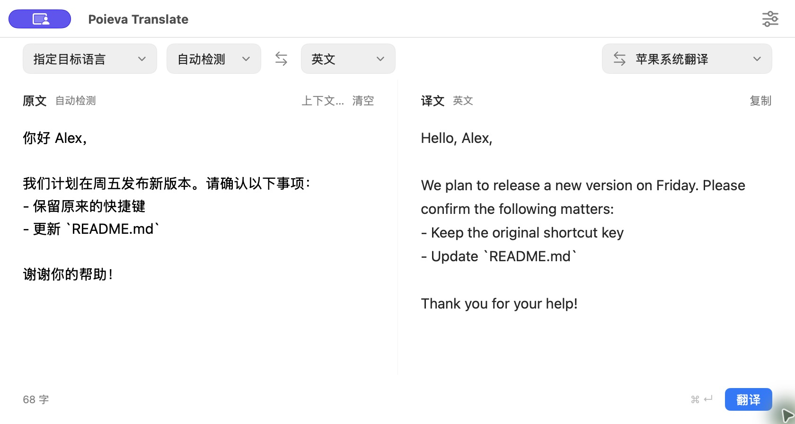
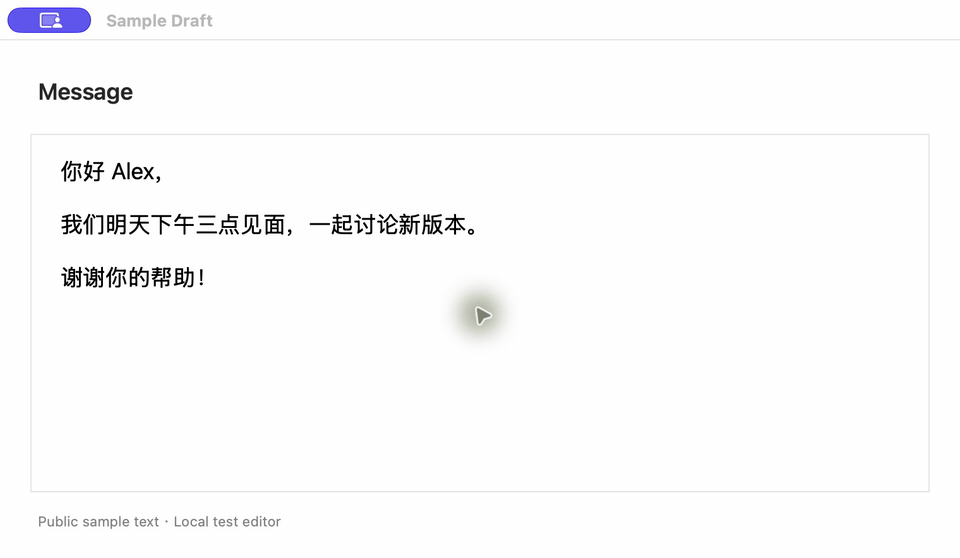
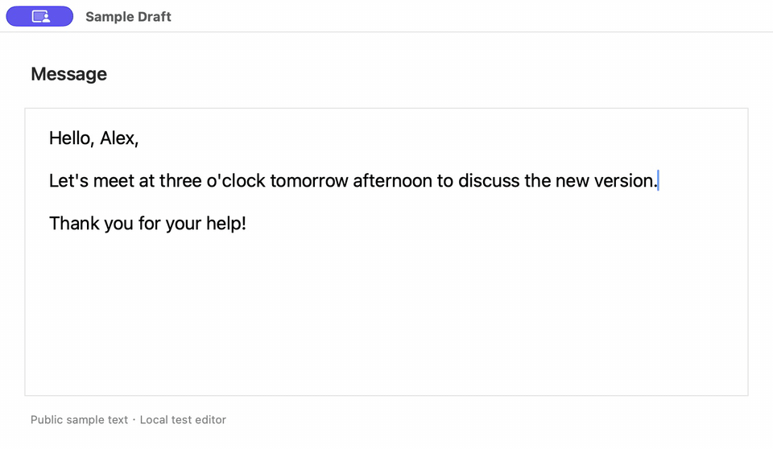

  

<h1 align="center">Poieva Translate</h1>

在输入框里直接翻译，选中文字随时查看译文。

<a href="README.md">English</a> · <strong>简体中文</strong>

  <a href="https://github.com/King87125/Poieva-Translate/releases/download/v0.1.0/Poieva-Translate-0.1.0.dmg"><strong>下载 Mac 版</strong></a>
  · <a href="https://github.com/King87125/Poieva-Translate/releases/tag/v0.1.0">发布说明</a>

Apple Silicon（M 系列芯片）· macOS 26+ · English / 简体中文

*真实应用截图，使用公开示例文字和内置翻译服务。*

## 可以做什么

- **在原输入框里翻译。** 按一次快捷键，替换整段草稿；选中一句时，只替换这一句。
- **选中文字看译文。** 用小浮窗预览翻译，需要时再复制。
- **边写边译。** 在翻译窗口输入或粘贴，停顿后自动显示译文。
- **中英双向互译。** 自动判断中文或英文，也可以指定其他目标语言。
- **保留原来的结构。** 保留段落、列表、代码和链接；编辑器提供文字样式时，也会尽量保留。
- **按自己的习惯使用。** 自定义快捷键、界面语言和加载动效；还可以勾选多个翻译服务，分别查看译文。

## 快速开始

1. [下载 DMG 安装包](https://github.com/King87125/Poieva-Translate/releases/download/v0.1.0/Poieva-Translate-0.1.0.dmg)，打开后把 **Poieva Translate** 拖进 **Applications（应用程序）**。
2. 首次打开时，选择 **English** 或 **简体中文**。
3. 先在翻译窗口里输入或粘贴文字。默认使用苹果系统翻译，无需注册账户或填写密钥；缺少语言包时，在 **设置 → 系统 → 语言包** 下载。
4. 想在其他应用里翻译，再到 **设置 → 系统 → 辅助功能** 开启权限。只使用翻译窗口，不需要这项权限。

> **开发预览版：** v0.1.0 尚未完成 Apple Developer ID 签名与公证，macOS 可能拦截首次打开。当前安装包支持 M 系列 Mac，不支持 Intel Mac。

## 三种使用方式

*以下动图使用本地测试编辑器中的实机画面，做了画面排版和停留时间调整，便于看清变化。*

### 翻译并替换草稿

把光标放进其他应用的输入框，按 **Control + Option + Return**。没有选中文字时，翻译整个输入框；先选中一句话，就只替换这一句。

译文会留在输入框里，确认后再发送。需要撤销时，在原应用按 **Command + Z**。

### 预览选中的文字

选中文字后，按 **Control + Option + D**，在小浮窗中查看译文。需要时点 **复制译文**，原文会继续保留。

### 打开翻译窗口

从菜单栏打开 Poieva，在左侧输入或粘贴文字，停顿片刻，右侧就会显示译文。点 **复制** 取用结果，也可以按 **Command + Return** 立即翻译。

上图是一段中文消息的实际翻译结果：空行、列表和 `README.md` 文件名都保留了下来。输入英文也可以译回中文。

## 快捷键

| 操作 | 默认快捷键 |
| --- | --- |
| 翻译并替换 | **⌃⌥Return** |
| 预览选中文字 | **⌃⌥D** |
| 在翻译窗口立即翻译 | **⌘Return** |

前两个快捷键可在 **设置 → 快捷键** 中修改。已经保存过自定义快捷键时，以设置里显示的为准。

## 几个实用说明

- 关闭窗口后，Poieva 仍留在菜单栏，随时可以继续翻译。
- 在 **设置 → 通用设置 → 界面语言** 切换中英文，重新打开应用后生效。
- 不同编辑器的兼容程度有所区别。遇到无法读取的输入框，可以缩小选区，或把文字粘贴到翻译窗口。详见[兼容性说明](docs/compatibility.md)。
- 苹果系统翻译在语言包准备好后于本机运行；选择在线服务时，文字会发送给该服务。Poieva 不保存翻译历史。

## 更多

[进阶配置](docs/services.md) · [从源码构建](docs/development.md) · [验证记录](docs/verification.md) · [反馈问题](https://github.com/King87125/Poieva-Translate/issues)
