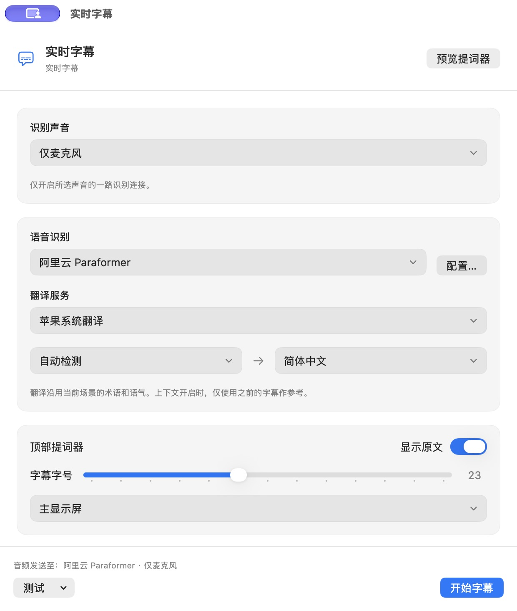

# 实时字幕 / Live Captions

Poieva 可以将应用播放的声音转换为文字，再使用现有翻译服务生成顶部双语字幕。入口在工作台右上角的字幕按钮、应用菜单和菜单栏的 **实时字幕…**。

## 开始使用

1. 打开 **实时字幕 → 语音识别 → 配置…**。添加配置默认选择 **阿里云 Paraformer**，已填好北京地址和 `paraformer-realtime-v2`，填写北京地域的百炼 API Key。也可选原有 **阿里云千问** 或 **Realtime 转写（兼容）**。语音识别配置与「翻译与辅助」配置分开。
2. 点「检查连接」可验证转写会话是否就绪，不会采集声音。保存后回到字幕窗口，选择该识别服务。
3. 在 **识别声音** 选择 **仅麦克风**、**仅系统声音** 或 **系统声音和麦克风**。两个单路模式只开启一条识别连接；双路会分别采集、分别识别，可能分别计费。选系统声音时，再指定全部系统声音或正在运行的应用；浏览器按整个应用采音，不区分标签页。旧版勾选麦克风的设置升级为「仅麦克风」，双路需要重新明确选择。
4. 选择苹果或已配置的翻译服务，以及原文/目标语言。原文语言用于翻译方向；识别接口自行识别输入语音。字幕使用当前翻译场景的术语与语气；全局上下文开启时，仅传入之前的字幕作为参考。
5. 点 **开始字幕**。仅麦克风模式只使用麦克风权限；系统声音模式使用系统音频录制权限，双路需要两种权限。只预览提词器或测试音频文件不采集麦克风和桌面声音。

### 36K 与免费额度

Paraformer 实时识别的 **36K 秒 = 36,000 秒 = 600 分钟 = 10 小时**。官方北京地域价格页列出每月发放 10 小时额度，当月有效，不累计；具体可用额度以你的控制台为准。它不是不限量服务，超额可能按量收费。请在百炼开启该模型的 **免费额度用完即停**，并确认 ASR 模型权限已开通。Poieva 不读取云端账单或修改该开关。

同一时间两路声音会分别消耗用量。测试自己说话请选「仅麦克风」；只听会议对方声音请选「仅系统声音」。静音时长也可能进入服务商计量，不要用说了几句话推算费用。结束时点暂停或停止。

`qwen-audio-3.1-asr-flash-streaming` 的 1M 是 Token 额度，不能与 36K 秒直接相加。`sambert`、`tts` 是语音合成，不能用于字幕识别。本版先接入 Paraformer 和单路采音，其他 ASR 协议及额度自动路由留待后续，不会自动切换或回退到付费模型。

依据：[模型价格与月度额度](https://help.aliyun.com/zh/model-studio/model-pricing)、[免费额度与用完即停](https://help.aliyun.com/zh/model-studio/new-free-quota)。

字幕在主屏幕顶部中央展开。有刘海时，黑色表面从屏幕顶缘连续展开；收起时，字幕图标和展开按钮位于刘海两侧。默认显示当前一句，原文小字、译文大字；原文可关闭，字号和显示屏可调整。部分识别文字先显示，只有最终确定的句子才触发翻译，避免每个字都重复发送。

*实机提词器窗口截图，内容为公开预览样例；不代表会议采集或真实语音识别质量。*

鼠标移入字幕区后显示暂停、设置、收起和停止按钮；右键也可以打开操作菜单。暂停立即关闭采音和识别连接，保留已有字幕；停止同时清空本次字幕并关闭提词器。关闭设置窗口仍可显示字幕，在应用菜单重新打开设置即可操作。窗口支持 Command + W 关闭。

### Mac 顶部显示与系统灵动岛

这是一块使用官方 AppKit 窗口和显示屏几何接口实现的顶部字幕界面，并非 iPhone 的系统 Dynamic Island 组件。苹果在 Mac 上提供的 Live Activities 是从配对 iPhone 同步到菜单栏的实时活动；Poieva 的本机语音字幕采用独立的顶部窗口，不依赖 iPhone。刘海尺寸和位置通过 `NSScreen.safeAreaInsets`、`auxiliaryTopLeftArea` 和 `auxiliaryTopRightArea` 获取，不写死某款 Mac 的尺寸。

参考：[Apple Live Activities](https://developer.apple.com/design/human-interface-guidelines/live-activities)、[NSScreen 安全区域](https://developer.apple.com/documentation/appkit/nsscreen/safeareainsets)、[刘海左侧可用区域](https://developer.apple.com/documentation/appkit/nsscreen/auxiliarytopleftarea-uglc)。

## 先看效果和测试接口

- **预览提词器** 或「测试 → 预览提词器（不联网）」显示公开样例和滚动效果，不使用网络、麦克风或系统录音权限，界面明确标为「样例预览」。
- **测试 → 测试音频文件…** 会将用户选择的音频发送给所选识别 API，再使用所选翻译服务。支持 WAV、AIFF、MP3、M4A，最多 60 秒；这会产生所选服务的实际用量。测试完成并收到最终翻译后自动暂停连接。不要把它当成离线预览。

## API 要求

目前支持以下三类专门的语音转写接口。文字 Chat Completions 地址、普通 HTTP 翻译接口或任意一个聊天模型不会自动获得语音识别能力。

### 阿里云 Paraformer

- 本版适配 `paraformer-realtime-v2`（16 kHz），默认地址 `wss://dashscope.aliyuncs.com/api-ws/v1/inference`。也可使用官方推荐的 `wss://业务空间ID.cn-beijing.maas.aliyuncs.com/api-ws/v1/inference`，只支持北京地域。模型放在启动任务正文中，URL 不带 `model` 或 `intent` 参数。
- 发送带 UUID 的 `run-task`，收到同一任务的 `task-started` 后才采音。输入为单声道、小端 PCM16 / 16 kHz，使用 WebSocket 二进制帧发送。服务端 VAD 分句阈值为 600 ms，开启服务心跳以支持持续静音输入。
- 按句子的 `begin_time` 关联完整草稿与最终结果，草稿替换不拼接，忽略心跳文本。只有 `sentence_end=true` 的最终文字触发翻译。文件回放使用同一 `task_id` 的 `finish-task`，等待 `task-finished` 和最后一句翻译后自动暂停。
- 与原有千问配置使用相同来源的阿里云地址时，可在原配置中切换类型，保留已保存的密钥；更换服务来源仍需明确替换或清除密钥。

官方协议：[连接地址](https://help.aliyun.com/zh/model-studio/websocket-for-paraformer-real-time-service)、[客户端事件](https://help.aliyun.com/zh/model-studio/paraformer-client-events)、[服务端事件](https://help.aliyun.com/zh/model-studio/paraformer-server-events)。

### 阿里云千问

- 服务类型选 **阿里云千问**，默认模型 `qwen3-asr-flash-realtime`。北京默认地址为 `wss://dashscope.aliyuncs.com/api-ws/v1/realtime`，新加坡为 `wss://dashscope-intl.aliyuncs.com/api-ws/v1/realtime`。这两个旧域名仍获官方支持；也可填写官方推荐的 `wss://业务空间ID.cn-beijing.maas.aliyuncs.com/api-ws/v1/realtime` 或对应新加坡专属地址。密钥必须与地域对应。
- 应用自动添加 `?model=模型ID`，使用 Bearer 鉴权；输入为 16 kHz、单声道、小端 PCM16，按 200 ms 音频包持续发送，包含静音。
- 使用服务端 VAD 分句，停顿阈值 400 ms，不发送客户端手动 commit。每条客户端事件具有独立 `event_id`。先验证服务确认的模型、格式和分句模式，之后才采音。
- 阿里云的 `text + stash` 是当前句的完整草稿，用新内容替换旧草稿，避免累加重复。最终 `completed` 结果才触发翻译。音频文件发送完后通过 `session.finish` 收尾，等待 `session.finished` 与最后一句翻译完成，再自动暂停；用户手动暂停/停止仍立即取消。

官方依据：[WebSocket 接入与地域地址](https://help.aliyun.com/zh/model-studio/qwen-asr-realtime-interaction-process)、[客户端事件](https://help.aliyun.com/zh/model-studio/qwen-asr-realtime-client-events)、[服务端事件](https://help.aliyun.com/zh/model-studio/qwen-asr-realtime-server-events)。

### Realtime 转写（兼容）

这一类型保留原有 Realtime transcription 协议，不会改变已保存的旧配置：

- 地址可填写完整的 `wss://api.example.com/v1/realtime`，也可填 `https://api.example.com/v1`，应用会转换并添加 `/realtime?intent=transcription`。非标准路径按填写的路径使用。远程要求 WSS；明文 WS 只允许 localhost/回环地址用于开发。
- 密钥通过 `Authorization: Bearer …` 请求头传递，不支持把密钥写入 URL。更换服务来源时需要重新填写或清除旧密钥。密钥保存在既有的固定钥匙串组件中，不写入配置偏好。
- 客户端发送 `session.update`，会话类型为 `transcription`；转写模型由用户填写。输入为 24 kHz、单声道、小端 PCM16，关闭服务端分句，按 200 ms 音频包发送。
- 收到匹配转写模型的会话确认后才开始采音。客户端用轻量能量门限识别停顿，在约 600 ms 静音或最长约 8 秒时提交一段；这不是本地 AI 模型。
- 服务需支持 `input_audio_buffer.append`、`input_audio_buffer.commit` 和对应的增量/完成事件。客户端按 `item_id` 匹配原文和译文，处理乱序及重复结果。

协议依据：[OpenAI Realtime transcription](https://developers.openai.com/api/docs/guides/realtime-transcription)。例如官方文档中的转写模型也需要对应账户权限；其他服务声称兼容时，仍需检查具体协议。

## 腾讯会议自测

1. 在模型管理中为阿里云配置点 **检查连接**，成功后保存。该按钮只验证会话，不采音，也不证明语音识别质量。
2. 在腾讯会议创建自己的测试会议，用手机作为第二个参会端加入。电脑端麦克风静音，手机端读公开例句；让电脑端能听到来自手机的会议声音。
3. Poieva 选择 **仅系统声音 → 腾讯会议**，翻译服务选 **苹果系统翻译**，目标语言设为 **简体中文**，单独验证会议传来的声音。
4. 点 **开始字幕**，首次录音权限由你在 macOS 中确认。手机端读：`Today's meeting is about the project timeline. We plan to finish the first version next Friday.` 检查顶部是否先出现英文，再出现对应中文。
5. 单人会议没有远端声音。只有一台设备时，可选 **仅麦克风** 做本人语音测试，但这验证的是独立麦克风路径，不能据此认定腾讯会议的对方声音已通过。
6. 测试后点 **暂停** 或 **停止** 关闭采音与 API 连接。若有问题，反馈界面错误和声音来源即可。

## 隐私和运行方式

声音只在用户开始后采集，并发送至其选择的识别服务；识别文字交给所选翻译服务。苹果基础翻译仍使用本机已有语言包；选用 AI 翻译或场景辅助时，文字会进入对应 API。服务端如何留存及计费由各服务决定。

Poieva 不将音频或字幕写入历史、日志或配置文件。内存中只保留有限音频包、近期字幕和有限待译队列。暂停和停止会取消请求并丢弃迟到结果；断线、无效返回、翻译失败或队列跟不上时暂停并显示错误，需用户手动再次开始，不自动重连或重试计费请求。电脑休眠或桌面会话停用时暂停。

系统采音采用 macOS Core Audio tap，不安装虚拟声卡，不更改系统默认输入输出设备，不静音原应用。麦克风与系统声音分别识别，避免将两个音频时钟直接混合。音频格式变化时停止并提示重新开始。[Apple 音频采集说明](https://developer.apple.com/documentation/coreaudio/capturing-system-audio-with-core-audio-taps)

## 当前验收范围

已通过客户端协议、取消、乱序、重复、失败停止、缓冲上限和密钥来源隔离检查；原生 UI 使用公开合成音频、本机固定识别响应和真实苹果翻译验证。

*v0.4.0 链路验收截图，当前顶部样式见上方预览图。识别原文由本机固定协议样例返回，中文来自实际苹果翻译。文件测试完成后自动暂停并关闭连接。*

Paraformer 新增客户端协议、二进制音频、任务匹配、草稿/最终结果、额度错误、取消以及声源迁移检查；本机公开 AIFF 经真实应用重采样、固定 Paraformer 协议样例和实际苹果翻译，显示 `Hello, how are you? → 你好，你好吗？`，结束后自动暂停。

本机样例不是语音识别模型，不能证明识别准确率或云端延迟。此前千问版本的麦克风路径得到用户可用、速度可接受的反馈；本版 Paraformer 的真实云端识别尚待用户确认免费额度与用完即停后测试。腾讯会议远端音频、飞书、浏览器、设备切换、长时间运行、全屏与多屏仍需分别验收。受保护视频的声音可能无法采集，不承诺所有应用兼容。

## English

Open **Live Captions** from the toolbar or app/menu-bar menu. New speech configurations default to **Alibaba Cloud Paraformer**, with the Beijing endpoint and `paraformer-realtime-v2` prefilled. Confirm your cloud quota, enable **Stop When Free Quota Runs Out** in Model Studio and enter the Beijing API key. The listed monthly 36K-second allowance equals 10 hours; it is not unlimited, does not roll over, and actual account eligibility is controlled by the provider. Qwen and Realtime-compatible types remain available.

Choose **Microphone only**, **System audio only**, or **System audio and microphone**. Each single-input mode opens exactly one recognition connection; both inputs may be billed separately. Upgrading the old additive microphone checkbox selects microphone-only, never silently restores two connections. File testing always uses a single file input. No automatic model routing is included in this version.

Paraformer uses UUID-correlated `run-task` / `task-started`, 16 kHz mono binary PCM frames, server VAD and corrected sentence snapshots. File replay drains with `finish-task` / `task-finished`. The original Qwen Realtime protocol and generic Realtime protocol remain separate. Keys can be retained when switching between Ali speech protocols on the same origin; keys are not moved to a different origin.

For Qwen, the model and Beijing endpoint are filled in by default; enter your region's Model Studio API key, or select Singapore/use a workspace-specific endpoint. Qwen receives 16 kHz mono PCM16 with server VAD. Its corrected full-sentence previews replace earlier drafts. File tests send `session.finish` and wait for `session.finished` and the final translation before pausing. The original Realtime-compatible type keeps 24 kHz PCM16 and client-side turn commits; old configurations retain that type.

Starting captions requests permission for the selected source: microphone access for microphone-only, system audio recording for system-only, and both for dual input. A continuous dark surface expands from the display edge around the notch, with compact controls on either side when collapsed. On displays without a notch, it appears below the menu bar. It shows the current source/translated sentence, supports collapse, pause, text size and display selection, and does not take keyboard focus. Translation reuses Apple or your existing configured service and the active scene. Browser audio is captured per application, not per tab.

The top display uses public AppKit window and screen-geometry APIs; it is not the system iPhone Dynamic Island. Apple's Live Activities on Mac are mirrored from a paired iPhone into the menu bar. Poieva's local captions do not require an iPhone.

**Preview Teleprompter** is an offline, explicitly labeled sample. **Test an Audio File** sends the chosen file to your selected recognition service and translator, accepts up to 60 seconds, and automatically pauses after the final result. Only final transcripts are translated. Pausing stops capture and closes sockets while retaining current text; stopping clears the session. No audio or captions are saved to history. Remote service retention and charges are governed by that service.

The client has bounded buffers and translation queues, correlates results by item ID, and rejects late results after cancellation. Errors pause the session without automatic retries or reconnects. Recognition does not run a local AI model. The audio tap does not replace default audio devices or install a virtual driver.

Validation used public synthetic audio, fixed loopback WebSocket responses and real Apple translation. The new Paraformer path completed an in-app file test and paused automatically, without a cloud speech call. The earlier Qwen microphone path received positive user feedback; that does not establish live Paraformer quality or measured latency. To test Tencent Meeting's remote audio, use System audio only, join your own meeting from another device, mute the computer microphone and read the public sample from the other device. Long sessions and device/display combinations still need live testing. See [verification notes](verification.md).
