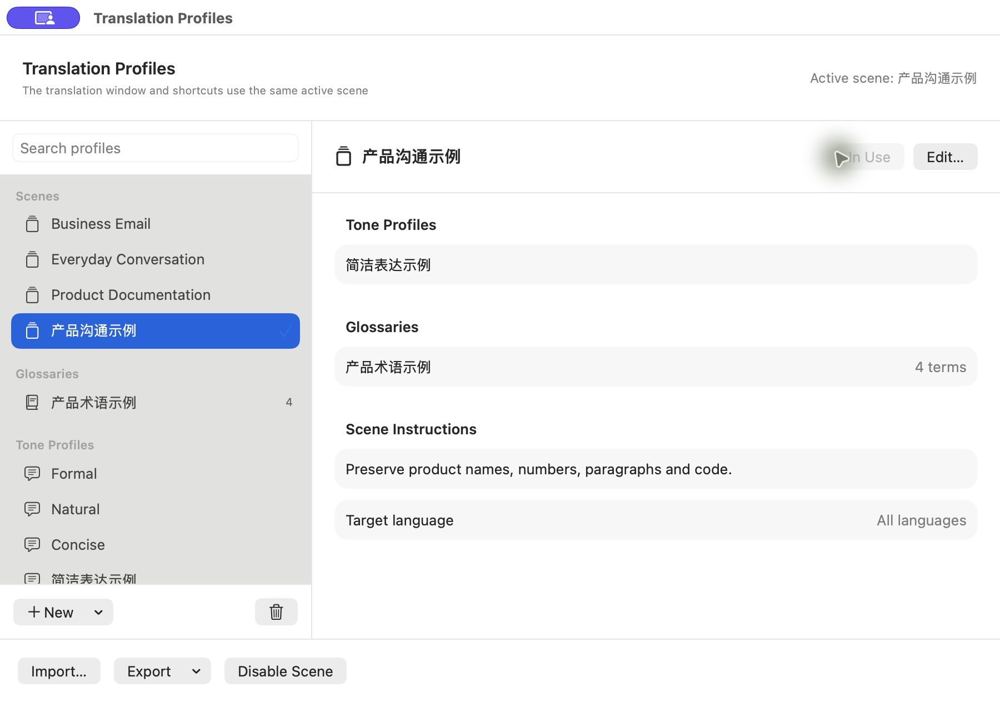

# 翻译方案 / Translation Profiles

术语库、语气配置和场景模板保存在本机，与翻译服务配置分开。工作台的「场景」栏、菜单栏的「翻译方案」和设置中的「管理方案」都能直接打开管理窗口。

*实机截图，使用可公开的示例配置；配置名称由用户填写，不随界面语言自动翻译。*

## 建立自己的方案

1. 点「新建 → 术语库」，填写名称。在编辑窗口添加术语，分别设置原文、固定译法与语言方向。产品名等不希望翻译的词可以开启「保留原文」。双击表格中的术语可编辑，也可以搜索后再修改。
2. 点「新建 → 语气配置」，选择基础风格，填写自己的表达规则；也可提供一组原文与译文例句，供模型参考措辞。
3. 点「新建 → 场景模板」，选择一个语气和所需的多个术语库，补充场景要求，例如不加称呼、保留列表。适用译文可以限定为某种语言；这不会改变工作台或快捷键本身的翻译方向。
4. 点「使用此场景」，或在工作台的「场景」下拉框切换。工作台自动翻译、手动翻译、全局翻译并替换、翻译预览均使用同一场景。选择会在退出后保留；切回「通用翻译」可停用方案。

预置商务邮件、日常沟通和产品文档三个可编辑场景，首次安装不启用任何场景。旧版非空的个人偏好会保留为「原有偏好」，原有术语与风格一起迁移，原始偏好记录保留。

## 翻译时如何使用

- AI 翻译在原来的单次请求中接收场景规则、语气及命中的术语，不额外启动本地模型。
- 苹果及普通 HTTP 翻译本身没有这些规则接口。需要在设置中选择用户自己的远程 AI 辅助，初译后再调用一次辅助接口。未配置辅助时，工作台场景栏会提示「需要 AI 辅助」；纯苹果模式继续提供基础翻译，不应把它当成已按方案调整的结果。
- 只匹配本次原文中的词，以及适用的原文、译文语言方向。ASCII 词使用词边界，避免把 `API` 命中到 `capital` 内部，同时支持 `API接口` 这类混合文本。代码、链接等受保护内容不用于术语检索。
- 对同一原文词，专门的目标语言优先于通用目标语言，其次优先专门的源语言。相同优先级有不同译法时明确报错，不悄悄覆盖。
- 切换或编辑当前场景会取消旧结果；快捷键操作开始时捕获场景快照，避免执行中混入新规则。场景不会扩大原文选区，也不会改变回填和格式保护逻辑。

语气、术语和例句通过模型指导生效，不进行译文的盲目字符串替换，也不保证模型每次严格遵守。例句仅供表达风格参考，不能用于增添原文没有的人物或事实。模型质量与真实第三方应用回填仍需分别验收。

## 导入与导出

管理窗口底部可以导入 JSON，或导出当前选中配置、全部方案。导出场景时自动包含关联的术语库和语气；单独导出术语库或语气时只包含该项。

导入会先完整校验，再一次性合并；不覆盖已有配置，不切换当前场景，完全相同的配置不重复添加。内部关联会重新映射，避免导入文件中的 ID 与本机记录相互覆盖。删除术语库或语气时，引用它的场景移除该关联，其余配置保留。

配置包格式为 `poieva.translation-profiles`、版本 1，与模型服务配置文件分开。不包含模型地址、API 密钥或当前场景选择。自定义规则与例句属于用户内容，请不要把密钥写入这些文本。

可导入示例：[`Examples/translation-profiles.json`](../Examples/translation-profiles.json)。它包含一个产品术语库、简洁表达语气和关联场景，导入后自行选择启用即可。

当前文件上限 4 MB，最多 200 个术语库、200 个语气、200 个场景，术语总数最多 10,000。单次请求只传命中的词，最多 64 条；超出时要求缩小翻译范围，不静默丢弃。场景及语气规则各最多 1,000 字，参考例句原文和译文各最多 500 字。术语原文最多 80 字，译法最多 200 字。

## English

Open **Manage Profiles** from the persistent Scene bar in the translation window, the menu bar, or Settings. Create a glossary with preferred translations and language directions; create a tone profile with writing rules and an optional example; then combine them in a scene. Select the scene in the translation window or choose **Use This Scene**. Both the translation window and global replacement/preview shortcuts use that scene, including after restarting the app.

AI translators receive matching terms and rules in their existing request. Apple and ordinary HTTP translators require a separately configured remote assistant to apply them. Without it, Apple still supplies basic translation and the scene bar indicates that AI assistance is needed. The app runs no local AI model for this feature. Model compliance is not guaranteed; source meaning, actors, formatting and writeback protection remain separate requirements.

**Export Selected Configuration** includes a scene’s linked glossary and tone. You can also export individual glossaries, individual tones or all profiles. JSON imports are validated and merged without replacing existing profiles or changing your active scene. Identical configurations are deduplicated and reference IDs are remapped. Service URLs, API keys and the active selection are not included.

Try the [public example](../Examples/translation-profiles.json), then edit it to suit your vocabulary. The package format is `poieva.translation-profiles`, version 1. It is separate from model/service configuration packages. Previous personal preferences migrate automatically on first use; new installations start with no active scene.
